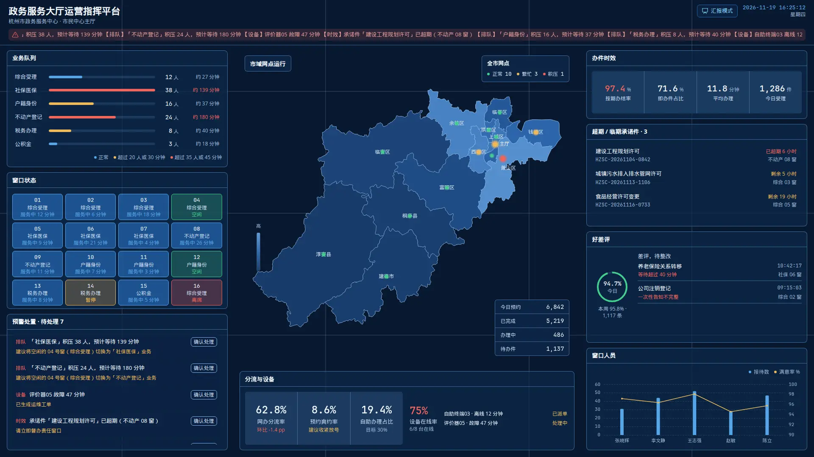
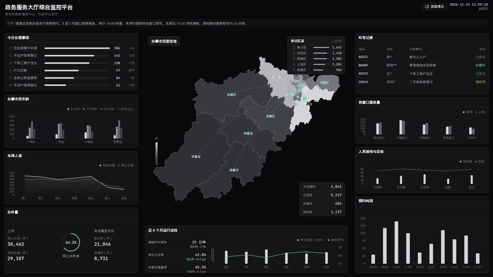

# 政务服务大厅综合监控平台

给大厅值班长看队列、窗口和预警的调度屏。切到汇报模式，则给视察看办件成效和市民居住地。按 1920×1080 设计，数据全部来自仓库里的 Mock，不接真实排队或好差评系统。

线上页从 `main` 发布：<https://suijiafeng.github.io/gov-service-dashboard/>。合并前，线上仍是上一版界面。





<table>
<tr>
<td width="400" align="center" valign="top"><br>超过 20 分钟会提示分流</td>
<td width="400" align="center" valign="top"><br>点击网点看队列和当日等待</td>
</tr>
<tr>
<td width="400" align="center" valign="top"><br>督办发出后按钮锁住</td>
<td width="400" align="center" valign="top"><br>窄屏窗口排成两列</td>
</tr>
</table>

## 功能

- 顶栏切换调度 / 汇报。调度看队列和窗口，汇报看办件、人流和居住地。
- 16 个窗口可点开详情。办理超过 20 分钟时，多一句分流提示。
- 预警可以「确认处理」，超期承诺件可以「发送督办通知」。两处都只改当前页面，刷新就没了。
- 告警由纯函数算出来：排队人数或预计等待、设备故障或离线、已超期承诺件。红色排在黄色前面。
- 杭州市域地图。点击区县或网点打开该网点的队列和当日等待。
- 每个面板都有加载、空数据和失败重试。宽于 1100px 时整页按 1920×1080 等比缩放，更窄时三栏改为纵向滚动。

## 技术栈

React 19 · TypeScript · Vite 7 · Tailwind CSS 4 · ECharts 6 · autofit.js

## 实现上值得看的地方

- 页面不直接读 Mock。组件调用 `src/api` 的异步函数，换真实接口时可以只改这一层。
- 阈值、预计等待和排序在 `src/utils/alertEngine.ts`，组件只负责展示和本地确认。
- `useApiData` 把 loading、error、empty 和 retry 收成同一种返回值。
- ECharts 只注册用到的图表。`vite-plugin-singlefile` 把构建打成单个 `dist/index.html`，GitHub Pages 在 `main` 上发布它。

## 本地运行

需要 Node.js 20 或更新版本。没有登录。

```bash
npm install
npm run dev
```

打开 <http://127.0.0.1:5173/gov-service-dashboard/>。开发服务器监听 `127.0.0.1`。

`npm run typecheck` 做类型检查，`npm run build` 再打出 `dist/index.html`。

## 目录

```text
src/api/                 Mock 异步接口
src/components/          顶栏、两种模式的三栏、地图和弹窗
src/hooks/useData.ts     加载、失败、空数据和重试
src/utils/alertEngine.ts 告警规则
vite.config.ts           base 为 /gov-service-dashboard/，host 为 127.0.0.1
```

叫号姓名已脱敏，网点和办件主体是虚构的。本仓库是个人项目，仅供学习交流。
