# 政务服务大厅综合监控平台

面向政务服务大厅的双模式可视化大屏：默认「调度模式」给值班长看队列、窗口和预警，「汇报模式」给视察展示办件成效与市民居住地分布。界面按 1920×1080 设计，数据全部来自仓库内的 Mock，不接真实排队、一窗或好差评系统。

A single-file React dashboard for a government service hall. Dispatch mode is the live operations view; report mode is the briefing view. Everything on screen comes from local mock data.

[](https://github.com/suijiafeng/gov-service-dashboard/actions/workflows/ci.yml)
[](https://github.com/suijiafeng/gov-service-dashboard/actions/workflows/deploy.yml)

在线地址：<https://suijiafeng.github.io/gov-service-dashboard/>

Pages 工作流只在 `main` 上构建并发布 `dist/`。上面的地址当前能打开，内容对应 `main`，还没有 `develop` 上的查询态和手机纵向布局。看这两块请在本地跑 `develop`。

## 界面

截图来自本地开发服务器和内置演示数据。叫号记录里的姓名已脱敏，网点电话和办件主体都是虚构的。

### 1920×1080 大屏

调度模式是默认首页。左栏是队列、窗口矩阵和预警，中栏是杭州市域网点，右栏是时效、承诺件、好差评和人员绩效。

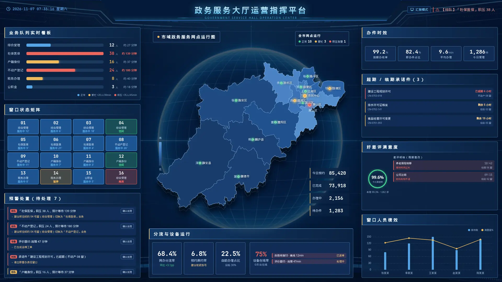

汇报模式换掉左右两栏和地图语义：办理事项、年龄与人流、居住地分布、叫号记录和近 6 个月成效。区县到主厅有飞线。

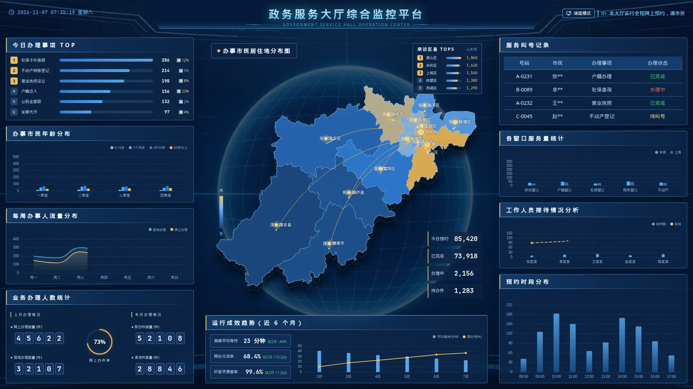

点窗口格子或地图区县会打开详情。下图是点击桐庐县后的网点弹窗，Esc 或点击遮罩关闭。

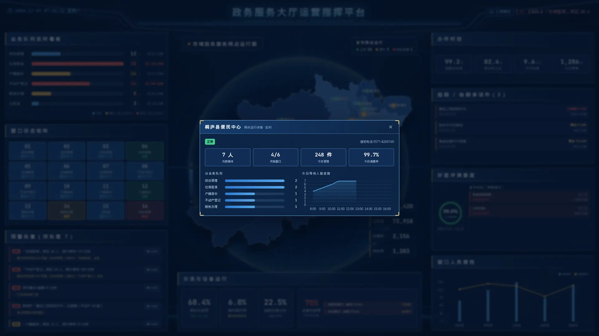

窗口详情同样是本地数据。办理超过 20 分钟时，弹窗里会多一句分流提示。

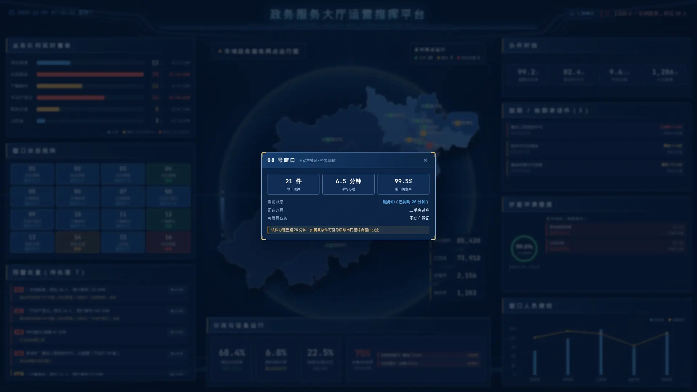

### 1440×900 桌面

窄于设计稿时，`autofit.js` 按 1920×1080 等比缩小整页。1440×900 下缩放比是 0.75。

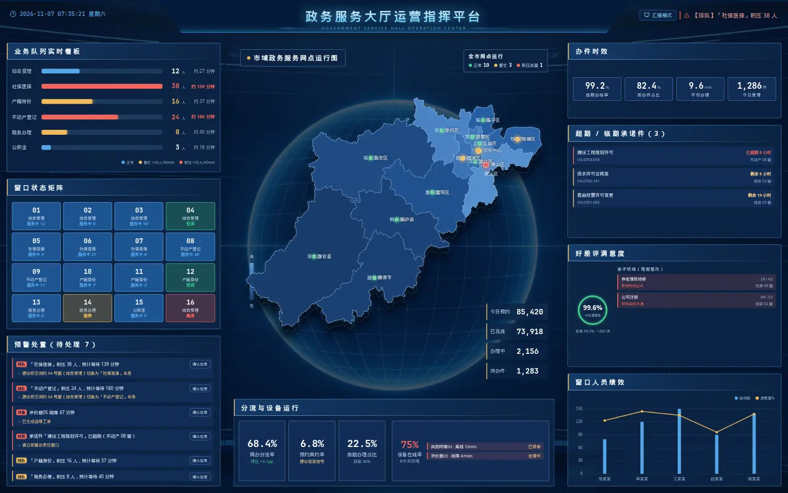

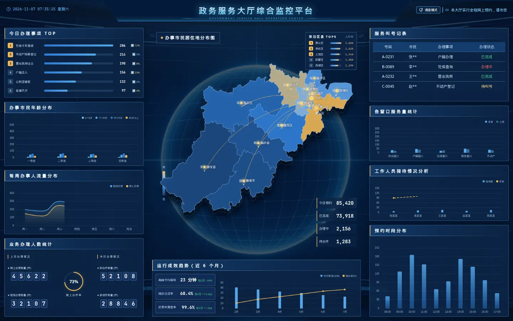

### 加载、空数据和失败重试

每个面板都走 `QueryState`。Mock 正常时大约 80–150 毫秒后就会有数，所以下面三张图是把同一套界面分别停在加载、空列表和接口抛错上看到的真实状态，不是另做的页面。

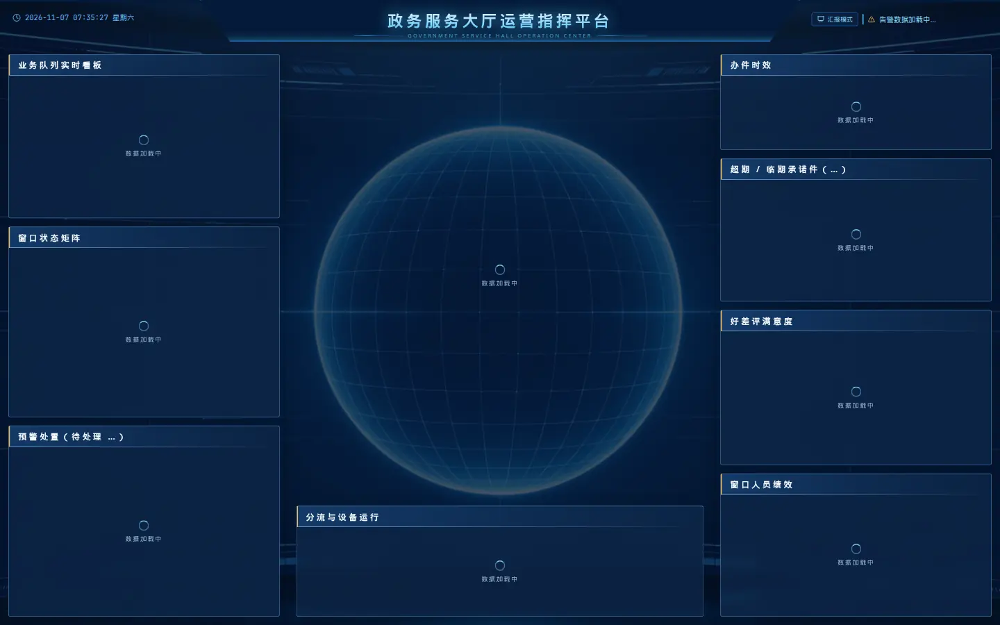

列表类面板空数据时显示「暂无数据」。预警和超期清单把空列表当成正常结果：没有预警就写「大厅运行平稳」，没有承诺件就写「无超期与临期承诺件」。带数字的 KPI 对象不会被当成空，会显示 0。

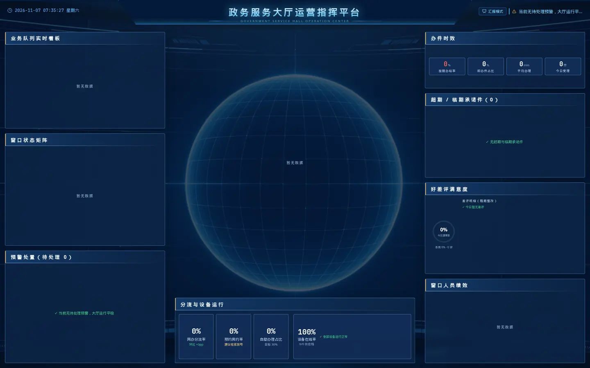

请求抛错时，面板和顶栏都可以点「重试」。重试会重新执行对应的 Mock 请求。

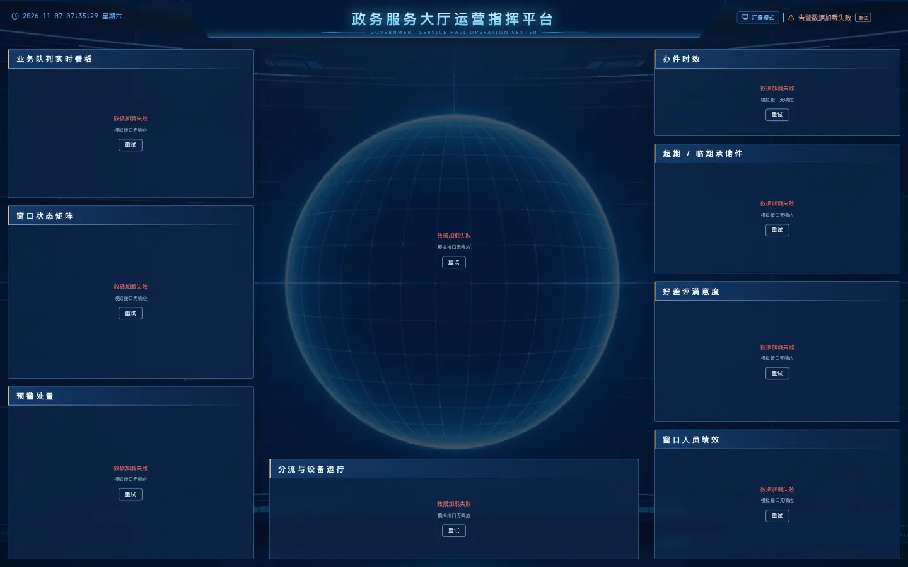

### 手机（375×812）

宽度小于 768px（样式写的是 `max-width: 767px`）时关掉整页缩放，三栏改成纵向滚动，图表给固定高度。下面两张是视口截图，不是把 1920 画布缩进手机。

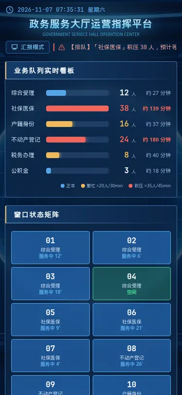

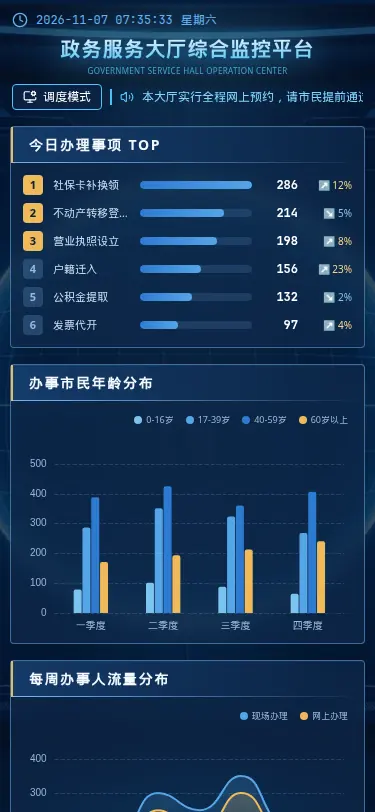

地图、网点图例和底部 KPI 在手机上改为文档流，不再叠在地图四角。


## 功能

### 两种模式

顶栏按钮切到另一种模式。调度模式标题是「政务服务大厅运营指挥平台」，汇报模式是「政务服务大厅综合监控平台」。

| | 调度模式 | 汇报模式 |
| --- | --- | --- |
| 左栏 | 业务队列、16 个窗口的状态矩阵、预警处置 | 今日办理事项 TOP、年龄分布、每周人流、办理量与网上办件率 |
| 中栏 | 市域网点运行图；底栏是网办分流、爽约率和设备 | 居住地分布、区县飞线、来访 TOP5；底栏是近 6 个月成效 |
| 右栏 | 按期办结、超期/临期承诺件、好差评、人员绩效 | 叫号记录、窗口服务量、接待与目标、预约时段 |
| 顶栏滚动 | 告警摘要；有红色告警时变红 | 公告原文 |

调度模式下，点击某一类队列会把其他业务的窗口格子压暗。点击承诺件可以看环节和滞留原因，并在本地点「发送督办通知」。预警可以「确认处理」。这两处都只改组件状态，刷新就没了。

### 告警规则

`src/utils/alertEngine.ts` 是纯函数。预计等待分钟数是 `排队人数 × 平均办理分钟 ÷ 开放窗口数`，没有开放窗口时视为无限长。

- 排队：等待人数超过 35 或预计等待超过 45 分钟为红；超过 20 人或 30 分钟为黄。红色且有其他业务的空闲窗口时，会给出改窗建议。
- 设备：故障，或离线超过 30 分钟，为红；其余非在线为黄。
- 时效：承诺件级别为 `overdue` 时为红。临期件只出现在右栏清单里，不进告警条。

红色排在黄色前面。顶栏和左下角共用同一次计算。

### 查询状态

`src/hooks/useData.ts` 的 `useApiData` 统一处理 loading、error、empty 和 `retry`。空值判断认空数组、空字符串，以及「里面只有空数组 / 空字符串 / 空对象」的对象；对象里只要有数字，就不算空。`combineQueries` 把多路请求合成一块面板的状态。`src/components/QueryState.tsx` 负责转圈、错误文案、重试按钮和「暂无数据」。

### 大屏和手机

桌面用 `autofit.js`，设计尺寸 1920×1080，随窗口缩放。手机宽度不初始化 autofit，避免 1920 的字被缩到无法阅读。双击标题进入或退出全屏。

### 图表

图表只注册地图实际用到的模块：地图、飞线、涟漪散点、柱状图、折线图，以及 geo、grid、tooltip、visualMap 和 canvas 渲染器，见 `src/lib/echarts.ts`。汇报模式的年龄、人流、窗口服务量和人员接待会按定时器做小幅随机波动，只为了让演示看起来在动，不是实时接口。叫号表每 2.5 秒滚 4 行。居住地 TOP 区县每 3 秒轮流高亮。

## 技术栈

| 部分 | 版本 / 位置 |
| --- | --- |
| React / React DOM | 19.2.3 |
| TypeScript | 5.9.3，`strict` |
| Vite | 7.2.4 |
| Tailwind CSS | 4.1.17，`@tailwindcss/vite` |
| ECharts | ^6.0.0，按需引入 |
| echarts-for-react | ^3.0.6，使用 `esm/core` |
| 单文件打包 | vite-plugin-singlefile 2.3.0 |
| 大屏缩放 | autofit.js ^3.2.8 |
| 图标 | lucide-react ^0.575.0 |
| 类名 | clsx 2.1.1、tailwind-merge 3.4.0，`src/utils/cn.ts` |
| CI | Node.js 20，`.github/workflows/ci.yml` |

没有测试框架，也没有后端。`npm test` 会提示缺少 `test` 脚本。

## 架构

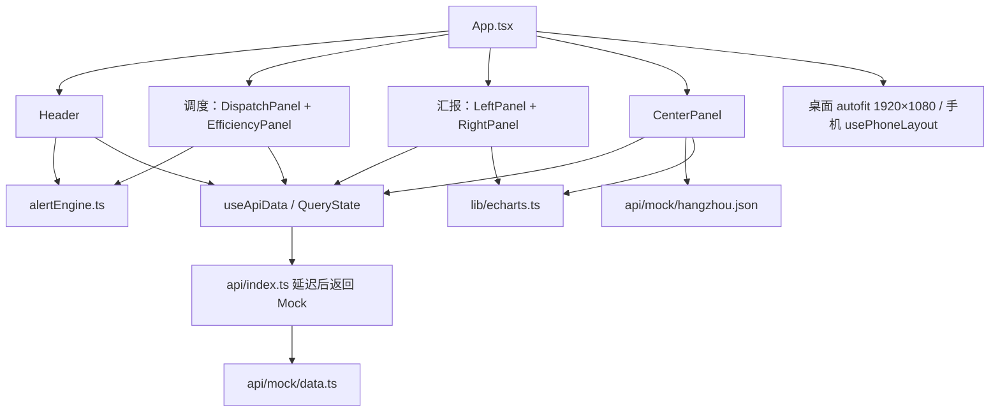

页面不直接读 Mock。组件调用 `src/api/index.ts` 里的异步函数，函数等待几十到一百多毫秒后包一层 `{ code, data, message }`。换真实接口时，组件和 Hook 的返回形状可以保持不动，改 API 层即可。代码注释把排队叫号、一窗受理和好差评标成后续对接，当前仓库里没有这些客户端。

## 快速开始

需要 Node.js 20 或更新版本。CI 固定使用 Node.js 20；本机用 Node.js 22 跑通了下面的命令。

```bash
npm install
npm run dev
```

开发服务器默认端口 5173。`vite.config.ts` 把 `base` 设为 `/gov-service-dashboard/`，所以本地页面是：

<http://127.0.0.1:5173/gov-service-dashboard/>

没有演示账号。打开就是调度模式。

### 环境变量

运行时不读取环境变量，仓库里也没有 `.env` 示例。

| 名称 | 含义 | 默认值 | 是否必需 |
| --- | --- | --- | --- |
| — | 无。部署子路径写死在 `vite.config.ts` 的 `base` | `/gov-service-dashboard/` | 改 Pages 项目名时要一起改 |

### 检查与构建

```bash
npm run typecheck   # tsc --noEmit
npm run build       # 先 typecheck，再打出 dist/index.html
npm run preview     # 默认端口 4173，路径同样带 base
```

`npm run build` 在本仓库当前代码上产出单个 `dist/index.html`，约 1.18 MB，gzip 约 429 KB。单文件是故意的：`vite-plugin-singlefile` 会把动态 import 再内联回去，体积靠少注册 ECharts 模块和压缩背景图来控制，而不是拆包。

### 部署

`.github/workflows/deploy.yml` 在 `main` 的 push 或手动触发时执行：`npm ci`、typecheck、build，然后用 `actions/deploy-pages` 发布 `dist/`。CI（`.github/workflows/ci.yml`）在 `develop` 的 push 以及所有 pull request 上做同样的 typecheck 和 build，不部署。

## 项目结构

```text
.
├── .github/workflows/
│   ├── ci.yml                  # develop / PR：安装、typecheck、build
│   └── deploy.yml              # main：构建并发布 GitHub Pages
├── src/
│   ├── api/
│   │   ├── index.ts            # Mock 异步函数与返回类型
│   │   └── mock/
│   │       ├── data.ts         # 演示数据
│   │       └── hangzhou.json   # 中栏地图
│   ├── assets/bg.jpg           # 背景
│   ├── components/
│   │   ├── Header.tsx          # 时钟、模式切换、告警或公告
│   │   ├── DispatchPanel.tsx   # 调度左栏
│   │   ├── EfficiencyPanel.tsx # 调度右栏
│   │   ├── LeftPanel.tsx       # 汇报左栏
│   │   ├── RightPanel.tsx      # 汇报右栏
│   │   ├── CenterPanel.tsx     # 地图与底栏
│   │   ├── QueryState.tsx      # 加载 / 空 / 失败
│   │   ├── EChart.tsx          # 图表配置辅助
│   │   ├── Card.tsx
│   │   └── Modal.tsx
│   ├── hooks/
│   │   ├── useData.ts
│   │   ├── usePhoneLayout.ts
│   │   └── useCarousel.ts      # 数字递增、列表轮播、图表波动
│   ├── lib/echarts.ts
│   ├── utils/alertEngine.ts
│   ├── App.tsx
│   └── index.css               # 主题变量与手机布局
├── docs/screenshots/           # 本页截图
├── index.html
├── vite.config.ts
└── package.json
```

## 实现要点

- **构建会先做类型检查。** `package.json` 的 `build` 是 `tsc --noEmit && vite build`。CI 和 Pages 工作流里也各跑一遍 `npm run typecheck`。这是 `develop` 上 `ed47026` 加进去的。
- **单文件包只带用到的图表。** `src/lib/echarts.ts` 用 `echarts/core` 注册有限的 chart 和 component。地图组件单独用 `echarts-for-react/esm/core`，把这份 echarts 实例传进去。
- **查询失败可以按面板重试。** `useApiData` 用 `attempt` 状态触发重新请求，组件卸载后不再写入。顶栏在告警或公告失败时也有自己的重试按钮。
- **告警和画面分开算。** 阈值、等待时间和排序都在 `alertEngine.ts`，组件只负责展示和本地确认。
- **手机不缩放设计稿。** `usePhoneLayout` 监听 `(max-width: 767px)`。`App` 在手机上跳过 `autofit.init`，`src/index.css` 把 `.dash-main` 改成纵向，并把图表高度写成固定像素。
- **地图不发外网请求。** `CenterPanel` 直接 `echarts.registerMap('hangzhou', hangzhou.json)`。调度模式散点颜色表示网点正常、繁忙或积压；汇报模式散点改成统一的金色，并增加指向市民中心主厅的飞线。点击区县名称前缀能对上的网点，或点击散点，都会打开网点详情。

## 局限

这些都是当前代码里的事实，不是计划中的功能。

- 没有登录、权限、审计或服务端。督办和「确认处理」刷新后消失。
- 没有单元测试或端到端测试。能自动跑的只有 typecheck 和 build。
- 仓库根目录没有 `LICENSE`。
- `src/api/mock/china.json`、`provinceVisitData`、`mapFlowData`、`equipmentStats`、`serviceCategories` 仍留在数据层和 API 里，没有任何面板引用。全国城市飞线和自助终端排行不在当前界面上。
- 办理量字段还是早期的 `infant` / `adult` / `youth` / `elderly`。界面文案已经是网上办理、现场办理、即办件、承诺件。网上办件率存在 `educationStats.bachelor`，读取函数名叫 `getEducationStats`。
- 设备列表长度为 0 时，在线率走「没有设备则 100%」的分支，空数据截图里因此会看到 100% 和「全部设备运行正常」。
- 图表波动是前端定时改数字。它不会回到 Mock 原值，也不会和其他面板同步。
- `useDataRefresh` 和 `useHighlightCarousel` 写在 `useCarousel.ts` 里，当前组件没有使用。
- `src/assets/bg.jpeg` 没有被引用，页面用的是压缩后的 `bg.jpg`。

## 说明

仓库现在能演示的是布局、两种模式、告警规则、查询状态，以及同一套页面在大屏和手机上的两种排法。接入真实接口、账号和持久化处置不在这版代码里。

---
> **声明**：本仓库为个人项目，仅供学习交流。
