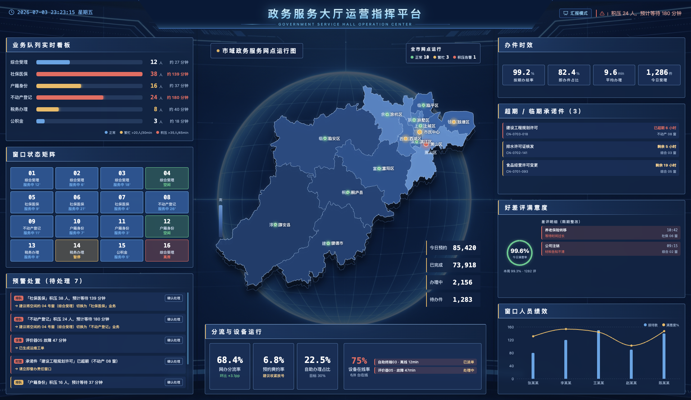
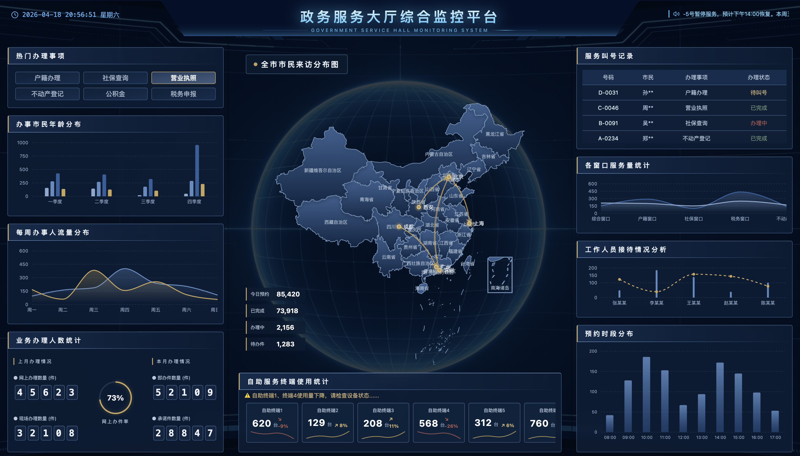

# 政务服务大厅综合监控平台

一个基于 React、TypeScript 和 Vite 构建的政务风格大屏可视化项目，适用于政务服务大厅的值班调度与汇报展示。

项目以杭州市域政务服务网点为示范场景，由内置 Mock 数据驱动。页面默认进入调度模式，也可切换到汇报模式。数据读取已经按异步请求组织，后续替换真实接口时改动集中在 `src/api`。

## 项目预览

在线预览：https://suijiafeng.github.io/gov-service-dashboard/

该地址与 `.github/workflows/deploy.yml` 的 GitHub Pages 部署一致：工作流在推送到 `main` 或手动触发时构建 `dist/` 并发布；`vite.config.ts` 中的 `base` 为 `/gov-service-dashboard/`。

调度模式截图：



调度模式（`dispatch`，默认）面向值班长的日常运营指挥。页头标题为「政务服务大厅运营指挥平台」。左侧是业务队列、窗口状态矩阵和预警处置；中部是市域网点运行图，以及分流与设备运行；右侧是办件时效、超期 / 临期承诺件、好差评和窗口人员绩效。页头跑马灯在存在告警时滚动实时预警，红色优先。

汇报模式截图：



汇报模式（`report`）面向领导视察或上级检查。页头标题切换为「政务服务大厅综合监控平台」。左侧是今日办理事项、年龄分布、周人流和业务办理统计；中部是办事市民居住地分布（区县着色、来访 TOP5、区县指向主厅的飞线）以及近 6 个月运行成效；右侧是服务叫号记录、窗口服务量、人员接待和预约时段。页头跑马灯展示公告。

页头右侧按钮在两种模式之间切换。双击标题进入或退出全屏。

整体视觉以深蓝底色、官蓝主色和金色点缀为主，贴近政务大厅和指挥中心的展示风格。

## 技术栈

- React 19
- TypeScript
- Vite 7
- Tailwind CSS 4
- Recharts
- ECharts + `echarts-for-react`
- `autofit.js`
- `date-fns`
- `lucide-react`
- `vite-plugin-singlefile`（构建为单文件静态页）

## 功能特性

- 按 1920 × 1080 设计稿用 `autofit.js` 等比缩放，并跟随窗口尺寸调整
- 调度 / 汇报两套左右侧栏，共用中部地图，由 `App` 中的 `DashboardMode` 切换
- 中部地图注册本地杭州 GeoJSON，展示区县居住地着色与市域网点散点；汇报模式增加飞线，并轮播高亮来访 TOP 区县
- 点击网点散点或区县面打开网点详情；调度模式还可打开窗口详情和承诺件详情
- `alertEngine` 按队列等待、设备离线 / 故障、承诺件超期生成红黄预警，调度模式支持确认处理
- 汇报模式保留数字递增、叫号列表轮播和图表波动刷新
- 页头时钟每秒刷新；双击标题切换全屏
- Mock API 模拟异步请求，便于替换为真实接口

## 环境要求

- Node.js 20

版本以持续集成为准：`.github/workflows/deploy.yml` 里 `actions/setup-node` 的 `node-version` 为 `20`。`package.json` 没有 `engines` 字段，仓库里也没有 `.nvmrc`。

## 快速开始

### 安装依赖

```bash
npm install
```

### 启动开发环境

```bash
npm run dev
```

### 构建生产版本

```bash
npm run build
```

### 本地预览构建结果

```bash
npm run preview
```

## 项目结构

```text
.
├── .github
│   └── workflows
│       └── deploy.yml                 # 推送到 main 时构建并部署 GitHub Pages
├── src
│   ├── api
│   │   ├── index.ts                   # Mock 异步请求封装
│   │   └── mock
│   │       ├── data.ts                # 演示数据
│   │       ├── hangzhou.json          # 杭州市域 GeoJSON，地图实际使用
│   │       └── china.json             # 全国 GeoJSON，当前组件未引用
│   ├── assets
│   │   ├── bg.jpg                     # 页面背景（App 引用）
│   │   └── bg.jpeg
│   ├── components
│   │   ├── Header.tsx                 # 标题、时钟、模式切换、告警 / 公告跑马灯
│   │   ├── DispatchPanel.tsx          # 调度模式左侧：队列、窗口矩阵、预警处置
│   │   ├── EfficiencyPanel.tsx        # 调度模式右侧：时效、承诺件、好差评、绩效
│   │   ├── LeftPanel.tsx              # 汇报模式左侧：事项、年龄、人流、办理统计
│   │   ├── CenterPanel.tsx            # 中部杭州地图、KPI 与底栏（两种模式共用）
│   │   ├── RightPanel.tsx             # 汇报模式右侧：叫号、窗口量、接待、预约时段
│   │   ├── Card.tsx                   # 通用卡片
│   │   └── Modal.tsx                  # 网点 / 窗口 / 承诺件详情弹层
│   ├── hooks
│   │   ├── useData.ts                 # 数据请求 Hooks
│   │   └── useCarousel.ts             # 数字递增、列表轮播、图表波动
│   ├── utils
│   │   ├── alertEngine.ts             # 排队、设备、时效预警规则
│   │   └── cn.ts                      # clsx + tailwind-merge
│   ├── App.tsx                        # 模式状态与三栏布局
│   ├── main.tsx                       # 应用入口
│   ├── index.css                      # 全局样式与主题变量
│   └── autofit.d.ts                   # autofit.js 类型声明
├── screenshot                         # README 预览截图
├── dist
│   └── index.html                     # 已纳入版本库的构建产物
├── index.html
├── vite.config.ts
├── tsconfig.json
├── package.json
├── package-lock.json
└── README.md
```

`.gitignore` 已列出 `dist/`。`dist/index.html` 在此之前已被跟踪，因此仍出现在仓库中。

## 数据说明

当前没有接入真实后端。页面数据来自：

- `src/api/mock/data.ts`：队列、窗口、网点、居住地、时效、好差评等演示数据
- `src/api/mock/hangzhou.json`：地图底图，由 `CenterPanel` 静态引入

数据流：

- `src/api/index.ts` 把上述数据包成带延迟的模拟异步响应
- `src/hooks/useData.ts` 用统一的 `useApiData` 提供给各面板

这样处理的结果是：演示不依赖后端，页面已经具备异步加载模型，替换接口时主要改 `api` 层。`src/api/index.ts` 里调度相关接口的注释写明，后续对接排队叫号、一窗受理和好差评时保持现有契约。

`mapFlowData`、`provinceVisitData` 以及 `useMapFlowData`、`useProvinceVisits`、`useEquipmentStats`、`useServiceCategories` 仍留在 API / Hook 层，当前面板没有调用。`useHighlightCarousel`、`useDataRefresh` 和 `cn` 同样已定义、尚未被组件使用。

## 地图说明

`CenterPanel` 在构建期引入 `src/api/mock/hangzhou.json`，挂载后执行 `echarts.registerMap('hangzhou', …)`，注册名为 `hangzhou` 的地图。底图阴影、描边和区县着色都使用这张杭州市域图。

区县填色使用 `residenceDistribution`（各区县办事市民居住占比）。网点散点使用 `siteData`：市民中心主厅，以及上城、拱墅、西湖、滨江、萧山、余杭、富阳、临安、钱塘、临平等分中心和桐庐、淳安、建德便民中心。散点大小随等待人数变化。

两种模式的差异：

- 调度模式标题为「市域政务服务网点运行图」。右上角汇总正常 / 繁忙 / 积压告警的网点数量，散点按状态着色。底栏是「分流与设备运行」（网办分流率、预约爽约率、自助办理占比、设备在线率及异常设备）。
- 汇报模式标题为「办事市民居住地分布图」。右上角是来访区县 TOP5。除主厅外，各网点指向市民中心主厅绘制飞线，散点统一为金色。每 3 秒轮播高亮居住量前五的区县。底栏是「运行成效趋势（近 6 个月）」。

两种模式右下角都显示今日预约、已完成、办理中、待办件。点击网点散点，或点击区县面（按区县名前缀匹配对应网点），会打开网点运行详情。

页面不会在运行时请求 `https://geo.datav.aliyun.com/areas_v3/bound/100000_full.json`。`src/api/mock/china.json` 保留在仓库中，当前没有被任何组件引用。

## 适用场景

- 政务服务大厅值班调度大屏
- 领导视察 / 上级检查时的汇报大屏
- 智慧园区 / 智慧城市可视化驾驶舱原型
- 数据可视化方案演示

## 后续可扩展方向

- 按现有 API 契约接入排队叫号、一窗受理、好差评等真实接口
- 接入 WebSocket / SSE 实时推送
- 在现有区县点击的基础上支持街道级地图下钻
- 增加时间筛选和跨图表联动
- 抽离图表配置，方便复用
- 增加多套行业主题或深浅主题
- 清理未被界面使用的全国地图数据与对应 Mock 接口

## 说明

- 当前仓库的重点是视觉呈现、信息编排和大屏适配
- 生产环境可以继续补充权限鉴权、错误兜底、加载态、监控埋点和测试用例

---
> **声明**：本仓库为个人项目，仅供学习交流。
